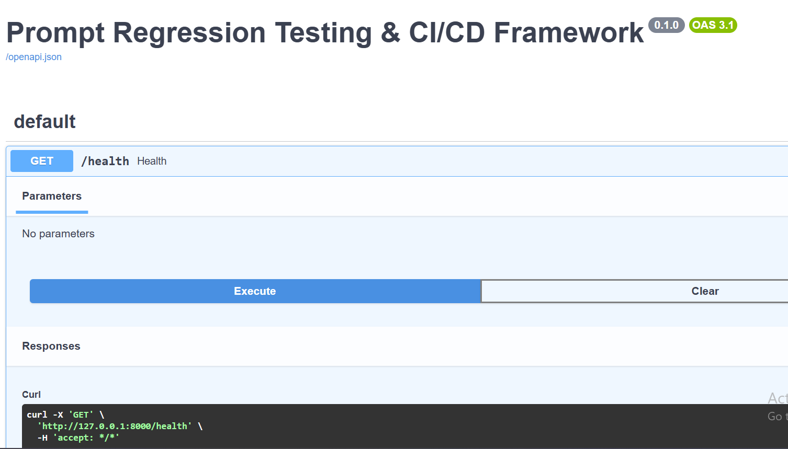
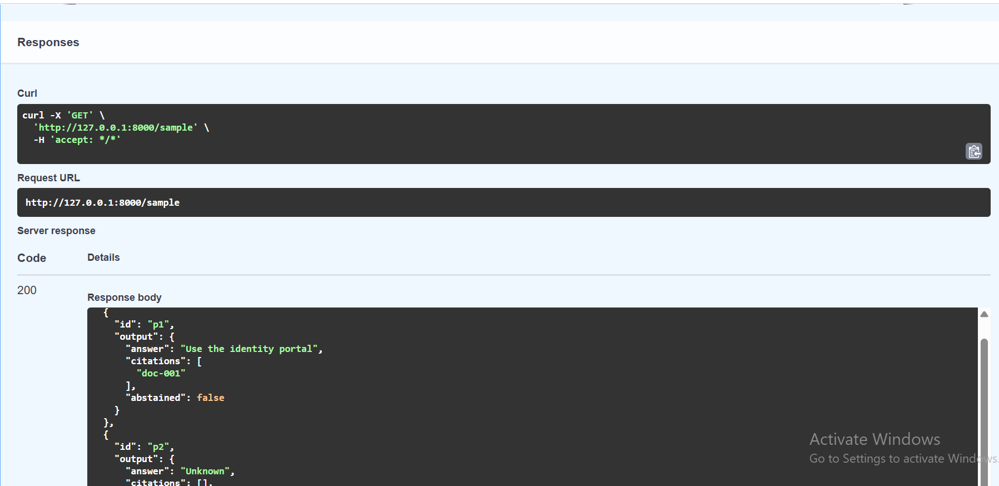
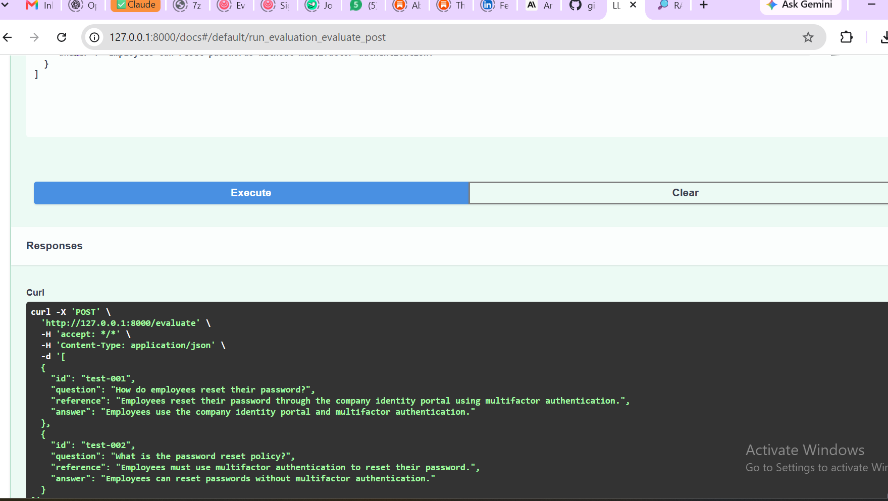
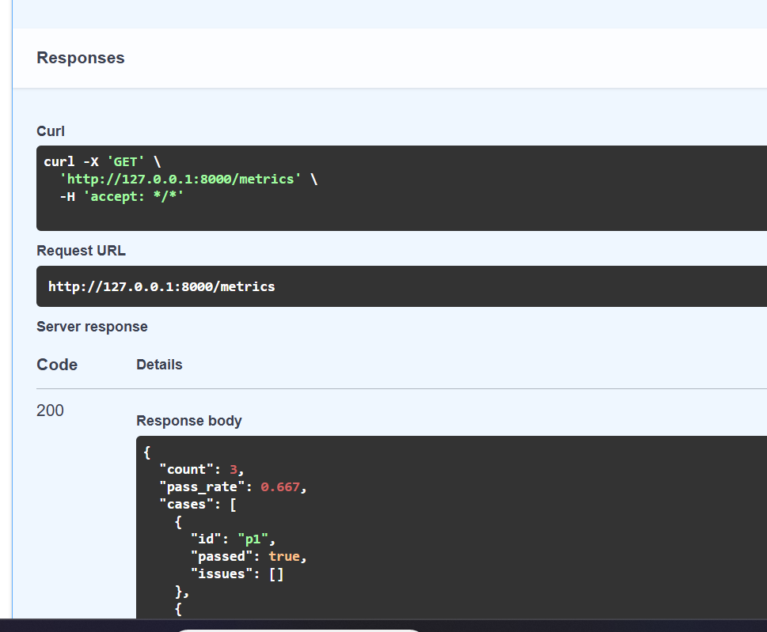

## Demo media — Prompt Regression Testing & CI/CD Framework

### API screenshots

### Demo recordings

- [Swagger API walkthrough](demo/swagger-api.mp4)
- [Streamlit dashboard walkthrough](demo/streamlit-dashboard.mp4)

The example regression checks demonstrate deterministic citation/abstention validation. A failed case is intentional. These demos do not establish production deployment or live model evaluation.
